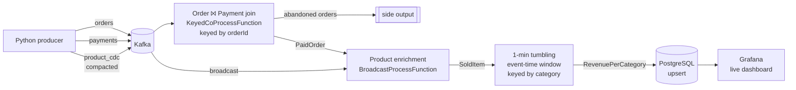

# Real-time E-commerce Analytics with Apache Flink

An event-time streaming pipeline that joins orders with payments, enriches sold items with a live product catalog (CDC), computes revenue per category per minute, and serves it on a live Grafana dashboard.

**Stack:** Python · Apache Kafka 4.3 (KRaft) · Apache Flink 2.2 (DataStream API, Java 17) · PostgreSQL 17 · Grafana 13 · Docker Compose

## Architecture



## What the pipeline does

| Stage | Flink building block | Details |
|---|---|---|
| Ingest | `KafkaSource` + custom `DeserializationSchema` | Generic Jackson deserializer; malformed records are logged and skipped instead of crash-looping the job (poison-pill handling) |
| Event time | `WatermarkStrategy` | Bounded out-of-orderness of 10 s for orders and payments, monotonous timestamps for CDC, idleness detection so empty partitions don't stall the watermark |
| Order ⨝ payment | `KeyedCoProcessFunction` + `ValueState` + event-time timers | Order is held in keyed state; a successful payment emits a `PaidOrder`. If no payment arrives within 60 s (event time), the order goes to an `abandoned-orders` side output |
| Enrichment | Broadcast state (`MapStateDescriptor`) | Product catalog arrives as Debezium-style CDC events (`r`/`c`/`u`/`d`) on a compacted topic and is broadcast to every subtask; each order item is enriched with name, category and brand |
| Aggregation | `TumblingEventTimeWindows` + `AggregateFunction` + `ProcessWindowFunction` | Incremental aggregation (one accumulator per category per window) with `BigDecimal` money; the window function attaches window start/end |
| Sink | JDBC sink (`flink-connector-jdbc-postgres`), at-least-once | `INSERT ... ON CONFLICT (window_start, category) DO UPDATE` makes replays idempotent |
| Fault tolerance | Checkpointing every 10 s | Kafka offsets, join state, broadcast state and window accumulators are snapshotted; checkpoints are retained on cancellation so the job can resume with `flink run -s` |

## Test data generator

`Producer/orders_payments_producer.py` generates realistic traffic **including the edge cases a streaming join has to survive**:

| Scenario | Share | Purpose |
|---|---|---|
| Normal | 85% | Payment 1–10 s after the order |
| Abandoned | 5% | No payment → timeout side output |
| Late payment | 4% | Payment arrives after the 60 s timeout |
| Duplicate payment | 3% | Same payment delivered twice |
| Amount mismatch | 2% | Paid amount differs from order total |
| Payment before order | 1% | Payment event reaches Kafka first |

Payment statuses are weighted (`SUCCESS`, `FAILED`, `PENDING`, `CANCELED`), and every 30 s a product is created, updated (price/category/brand) or deleted via a CDC event. The producer uses an idempotent Kafka producer with `acks=all`.

## Design decisions

- **Event time, not processing time.** Revenue is bucketed by when the payment happened, so replaying a topic produces the same numbers.
- **At-least-once sink + idempotent upsert instead of XA exactly-once.** The output has a natural key `(window_start, category)`, so duplicates from a replay overwrite the same row. XA transactions would only add commit latency tied to the checkpoint interval.
- **Natural primary key, not a random UUID.** A random key would never collide on replay and would silently create duplicates.
- **Broadcast state for the product catalog** instead of a per-record database lookup: the catalog is small, changes rarely, and lookups stay in memory with no external calls on the hot path.
- **`AggregateFunction` + `ProcessWindowFunction`** instead of a `ProcessWindowFunction` alone: Flink keeps one accumulator per key and window rather than buffering every element.
- **`BigDecimal` for money** to avoid floating-point drift in sums.
- **Postgres + Grafana instead of Elasticsearch + Kibana:** the output is time-bucketed metrics, which fit a SQL table; one sink instead of two.

## Running locally

**Prerequisites:** Docker, Java 17, Maven, Python 3.11+, a local Flink 2.2.1 distribution.

```bash
# 1. Infrastructure (Kafka, Postgres with schema from sql/, Grafana)
docker compose up -d

# 2. Producer (creates topics on first run)
cd Producer
python -m venv .venv && source .venv/bin/activate
pip install -r requirements.txt
python orders_payments_producer.py

# 3. Flink job
cd Flink-Ecommerce
mvn clean package
start-cluster.sh                         # needs >= 3 task slots
flink run target/Flink-Ecommerce-1.0-SNAPSHOT.jar
```

| UI | URL |
|---|---|
| Flink dashboard | http://localhost:8081 |
| Grafana (admin / admin) | http://localhost:3001 |

```sql
-- inspect results
docker compose exec postgres psql -U admin -d ecommerce
SELECT * FROM revenue_per_category ORDER BY window_start DESC, category;
```

Resume from a retained checkpoint:

```bash
flink run -s <checkpoint-dir>/<job-id>/chk-<n> target/Flink-Ecommerce-1.0-SNAPSHOT.jar
```

## Project layout

```
├── docker-compose.yaml          Kafka, Postgres, Grafana
├── sql/                         Postgres schema, applied on first start
├── grafana/dashboards/          Dashboard JSON
├── Producer/                    Topic creation + event generator
└── Flink-Ecommerce/             Flink job (Maven)
    └── src/main/java/FlinkEcommerce/
        ├── DataStreamJob.java   Job graph: sources → join → enrichment → window → sink
        ├── deserializers/       Generic JSON deserializer
        ├── dtos/                Event and result types
        ├── enums/               Payment method/status, CDC operation
        └── processFunctions/    Join, enrichment, aggregate, window function
```

## Known limitations

These are known and tracked in the roadmap below:

- **Payment before order is dropped.** The join only buffers the order; a payment that arrives first finds no state. On a full replay this makes results depend on which topic is read faster.
- **Late payments after the timeout are dropped** after the order was already marked abandoned.
- **Amount mismatches are not flagged**; they flow through as normal paid orders.
- **Window late data is dropped silently** (no `allowedLateness` or late side output yet).
- Connection settings and the checkpoint path are hard-coded for local development.

## Roadmap

- [x] Order ⨝ payment join with timeout side output
- [x] Broadcast-state product enrichment from CDC
- [x] Windowed revenue per category
- [x] Checkpointing + idempotent Postgres sink
- [x] Grafana live dashboard
- [ ] Join v2: buffer early payments, ignore duplicates, route late payments and amount mismatches to side outputs, state TTL
- [ ] Tests: operator test harness for the join, unit tests for the aggregate, MiniCluster end-to-end test
- [ ] Exactly-once failure demo: kill a TaskManager mid-stream and verify totals against a batch recount
- [ ] Window late data: `allowedLateness` + late side output
- [ ] Observability: Prometheus metrics reporter + pipeline-health dashboard
- [ ] Load test: throughput and latency numbers, HashMap vs RocksDB state backend
